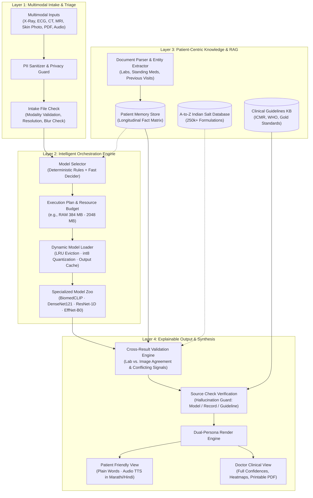
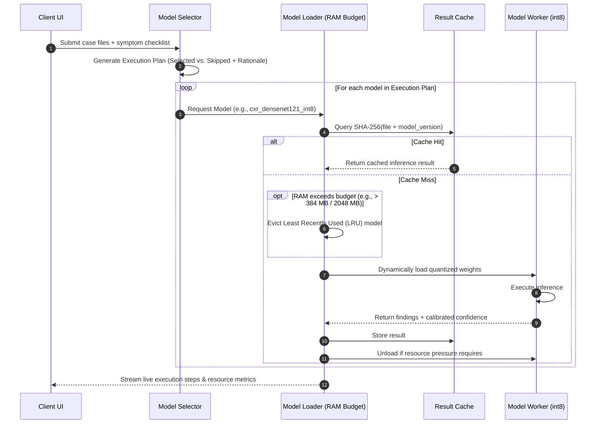
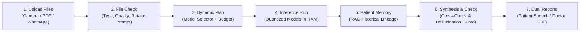

# EL-04: Multimodal AI Clinical Screening & Intelligence Platform

[](https://nextjs.org/)
[](https://react.dev/)
[](https://www.typescriptlang.org/)
[](https://tailwindcss.com/)
[](https://vitest.dev/)
[](LICENSE)

> **A unified clinical intelligence and screening platform that ingests multimodal medical data (X-rays, ECGs, CTs, MRIs, lab reports, prescriptions, audio), orchestrates specialized lightweight AI models under strict memory budgets, grounds findings in patient history and medical guidelines via RAG, and generates traceable, dual-persona screening reports in vernacular Indian languages.**

---

## 📑 Table of Contents

- [1. Executive Summary](#1-executive-summary)
- [2. Problem Statement & Real-World Motivation](#2-problem-statement--real-world-motivation)
- [3. High-Level System Architecture](#3-high-level-system-architecture)
- [4. The 4-Layer Modular Pipeline](#4-the-4-layer-modular-pipeline)
  - [Layer 1: Multimodal Intake & File Triage](#layer-1-multimodal-intake--file-triage)
  - [Layer 2: Intelligent Model Orchestration & Resource Manager](#layer-2-intelligent-model-orchestration--resource-manager)
  - [Layer 3: Patient-Centric Knowledge & RAG Layer](#layer-3-patient-centric-knowledge--rag-layer)
  - [Layer 4: Explainable Output & Clinical Traceability](#layer-4-explainable-output--clinical-traceability)
- [5. Multimodal Clinical AI Models & Condition Matrix](#5-multimodal-clinical-ai-models--condition-matrix)
- [6. End-to-End Clinical Screening Workflow](#6-end-to-end-clinical-screening-workflow)
- [7. Key Clinical Innovations](#7-key-clinical-innovations)
  - [Previous Visit Summary (PVS) & Salt Duplicate Alert](#previous-visit-summary-pvs--salt-duplicate-alert)
  - [Doctor Voice Instructions & Segmented Playback](#doctor-voice-instructions--segmented-playback)
  - [Multilingual Accessibility (Marathi, Hindi, English)](#multilingual-accessibility-marathi-hindi-english)
  - [Source Check Verification & Cross-Result Validation](#source-check-verification--cross-result-validation)
- [8. Dual-Persona Experience (Patient vs. Doctor)](#8-dual-persona-experience-patient-vs-doctor)
- [9. Tech Stack & Design System](#9-tech-stack--design-system)
- [10. Project Structure](#10-project-structure)
- [11. Quickstart & Local Setup](#11-quickstart--local-setup)
- [12. 3-Minute Judging Walkthrough](#12-3-minute-judging-walkthrough)
- [13. Ethical Guardrails & Clinical Limitations](#13-ethical-guardrails--clinical-limitations)

---

## 1. Executive Summary

Healthcare data is fundamentally **multimodal and fragmented**. A single patient visit produces diverse artifacts: paper prescriptions, digital blood panels, film X-rays, thermal ECG strips, CT/MRI discs, and verbal clinical advice. Today, diagnostic AI exists in isolated silos—an X-ray model knows nothing about the patient's blood sugar, while an ECG classifier ignores cardiac history or current medications.

**EL-04** solves this by delivering an **integrated screening and clinical decision support system**. It dynamically routes files to specialized disease models, executes inference under strict edge memory constraints (e.g. 384 MB - 2048 MB RAM) using quantization and LRU model caching, correlates current findings against longitudinal patient records, and renders a unified screening report where **every single claim is attributed with an inspectable source chip**.

```
┌──────────────────────────────────────────────────────────────────────────────┐
│  ⚠️ CLINICAL SCREENING DISCLAIMER                                           │
│  This platform is an assistive clinical screening and triage tool.          │
│  It is NOT an autonomous diagnostic medical device. It does not prescribe,   │
│  alter dosages, or substitute professional clinical evaluation. Emergency    │
│  cases trigger immediate escalation to emergency medical services (108).    │
└──────────────────────────────────────────────────────────────────────────────┘
```

---

## 2. Problem Statement & Real-World Motivation

Primary care delivery in high-density regions faces critical structural bottlenecks:

1. **Extreme Consultation Time Constraints:** In India, outpatient consultations often average **under 2 minutes** ([BMJ Open, 2017](https://bmjopen.bmj.com/content/7/10/e017982)). Clinicians do not have time to parse through thick paper bags of unstructured records.
2. **Information Retention Drop-off:** Patients forget **40% to 80%** of verbal medical instructions immediately after leaving the clinic room ([Kessels, JRSM 2003](https://journals.sagepub.com/doi/10.1177/014107680309600504)), leading to compliance failure and unintended drug interactions.
3. **Severe Specialist Scarcity:** India has approximately **1 radiologist per 100,000 citizens** (~22,000 total), with over 75% concentrated in tier-1 metropolitan hospitals. Small clinics need intelligent front-line screening to triage high-risk cases.
4. **Paper & WhatsApp Dispersal:** Over 85% of records exist as paper slips, physical X-ray films, or unindexed WhatsApp images.
5. **Brand Name Redundancy & Toxic Overdose:** The Indian pharmaceutical market has over 250,000 branded formulations. Patients frequently consume two different brands (e.g., *Dolo 650* and *Crocin 650*) unaware that both contain the identical active pharmaceutical ingredient (*Paracetamol*), risking hepatic toxicity.

---

## 3. High-Level System Architecture

The EL-04 architecture is structured into **four decoupled layers**: Ingestion, Orchestration, Knowledge Memory, and Explainable Synthesis.



---

## 4. The 4-Layer Modular Pipeline

### Layer 1: Multimodal Intake & File Triage
- **Universal Input Acceptance:** Accepts JPG, PNG, DICOM medical imaging, 12-lead ECG waveforms, laboratory PDF reports, handwritten prescription images, and recorded clinician speech.
- **Pre-Execution File Check:** Before invoking heavy computer vision models, the input passes through a lightweight zero-shot classifier (BiomedCLIP encoder) to confirm the anatomic region and modality (e.g. verifying that a chest model only processes thoracic radiographs).
- **Quality & Usability Guard:** Flags motion blur, low illumination, or severe downsampling, proactively asking the user for a clear recapture instead of generating unreliable predictions.
- **Client-Side Privacy Pre-filter:** Redacts patient identification numbers and personal identifiers before text summaries are processed.

### Layer 2: Intelligent Model Orchestration & Resource Manager
Addresses the core hackathon challenge: **How to execute multiple specialized medical AI models under constrained edge compute (CPU / limited RAM).**



- **Three-Tier Model Selection:**
  1. *Deterministic Category Rules:* Chest X-ray files immediately trigger TB and pulmonary opacity heads.
  2. *Context-Aware Fast Decider:* Evaluates reported symptoms (e.g., "shortness of breath + chest pain") to prioritize cardiac waveforms over unrelated heads.
  3. *Lightweight Fallback:* Selects `cxr_densenet121_int8` (180 MB) instead of fp32 (700 MB) when running in constrained RAM mode.
- **Dynamic LRU Cache & Quantization:** Retains a persistent shared image encoder (`biomedclip_encoder` at 95 MB) while swapping small specialized disease heads.

### Layer 3: Patient-Centric Knowledge & RAG Layer
- **Longitudinal Fact Extraction:** Normalizes values across past and current blood panels (e.g. mapping historical HbA1c from 7.2% to current 8.4%).
- **Dual Vector & Relational Store:** Combines indexed patient records with a curated clinical knowledge base (ICMR guidelines, WHO clinical criteria).
- **Pharma Cross-Reference Engine:** Indexes active chemical salts across 250,000+ Indian drug brands. Detects duplicate therapies and flags prior documented drug allergies (e.g., amoxicillin sensitivity).

### Layer 4: Explainable Output & Clinical Traceability
- **The Source Check Guarantee:** Every single sentence in the generated report must be anchored to a verifiable source. Unsupported claims are discarded.
- **Four Distinct Source Badges:**
  - <kbd style="background:#2563eb;color:white;padding:2px 6px;border-radius:4px;">MODEL</kbd> Prediction derived from deep learning model inference (includes calibrated confidence).
  - <kbd style="background:#16a34a;color:white;padding:2px 6px;border-radius:4px;">RECORD</kbd> Verifiable excerpt from the patient's uploaded past records or lab PDF.
  - <kbd style="background:#9333ea;color:white;padding:2px 6px;border-radius:4px;">GUIDELINE</kbd> Verified recommendation from national/international protocols (ICMR / WHO).
  - <kbd style="background:#4b5563;color:white;padding:2px 6px;border-radius:4px;">AI SUMMARY</kbd> High-level synthesis connecting two or more verified source items.
- **Cross-Result Agreement Validator:** Directly checks whether findings from different modalities corroborate or conflict (e.g., pulmonary consolidation on X-ray corroborated by elevated WBC count on blood test).

---

## 5. Multimodal Clinical AI Models & Condition Matrix

The platform covers **7 condition groups across 6 anatomical domains**, using open-weight models optimized for CPU inference:

| # | Anatomical Domain | Condition / Pathology | Modality | Model Architecture & Quantization | Base Dataset & Provenance | Illustrative Memory |
|---|---|---|---|---|---|---|
| **1** | **Brain** | Glioma, Meningioma, Pituitary Tumor | Brain MRI | BiomedCLIP Vision Head + EfficientNet-B0 (`int8`) | Kaggle Brain Tumor MRI Dataset | ~45 MB |
| **2** | **Lungs** | Pneumonia, Consolidation, Pleural Effusion (18 findings) | Chest X-ray | TorchXRayVision DenseNet121 (`int8` light switchable) | NIH ChestX-ray14 / CheXpert | 180 MB *(fp32: 700 MB)* |
| **3** | **Lungs** | Tuberculosis (TB) Risk Screening | Chest X-ray | Linear Screening Head on BiomedCLIP Embedding | Open TB Chest X-ray Database | 1 MB *(head)* |
| **4** | **Heart** | Arrhythmia, ST/T-Wave Changes, MI, Conduction Blocks | 12-lead ECG | 1D Convolutional ResNet-1D | PTB-XL Dataset (PhysioNet) | 12 MB |
| **5** | **Heart** | Cardiomegaly (Enlarged Cardiac Silhouette) | Chest X-ray | Multi-label DenseNet121 cross-checked with ECG axis | NIH ChestX-ray14 | Shared w/ #2 |
| **6** | **Skin** | Melanoma, Basal Cell Carcinoma, Benign Keratosis (7 classes) | Dermoscopy / Skin Photo | EfficientNet-B0 with custom clinical head | HAM10000 Dataset | 25 MB |
| **7** | **Kidney & Labs** | Renal Stones, Cysts, Tumors; Diabetes, Anemia, Electrolytes | Abdominal CT + Lab Reports | BiomedCLIP CT Head + Rule-based Biomarker Bounds | CT Kidney Dataset + Clinical Reference Intervals | 35 MB + 2 MB |
| **Core** | **Shared** | Universal Visual Embedding & File Verification | All Medical Imagery | BiomedCLIP Vision Transformer (`int8`) | PMC-15M Medical Image-Text Pairs | 95 MB *(always loaded)* |

---

## 6. End-to-End Clinical Screening Workflow



1. **Upload & Consent:** The patient uploads images, PDFs, or audio notes and grants digital screening consent.
2. **Quality Audit:** System inspects image dimensions and contrast; if a specimen is unreadable, it provides guidance for recapture.
3. **Execution Plan Generation:** The system determines exactly which models must execute and logs the reason for any skipped models.
4. **Controlled Execution:** Models are loaded into active memory within the designated RAM ceiling (e.g. 384 MB limit triggers int8 models and aggressive LRU eviction).
5. **Memory Retrieval:** The patient's longitudinal record is cross-referenced for related markers, baseline vitals, and ongoing treatments.
6. **Integrity Verification:** Model outputs and historical records are verified for consistency; discordant findings are highlighted with an honest "Not Sure" disclosure.
7. **Report Dissemination:** Output is formatted into simple plain text with speech synthesis for the patient, alongside an evidence-dense consultation sheet for the physician.

---

## 7. Key Clinical Innovations

### Previous Visit Summary (PVS) & Salt Duplicate Alert
Before a patient walks into the clinic, EL-04 constructs a 5-point consultation brief:
- **Previous Diagnosis & Date:** What problem brought the patient in last time.
- **Medications Prescribed:** Active treatments, duration, and patient-reported adherence.
- **Therapeutic Outcome:** Whether symptoms improved, remained static, or worsened.
- **Longitudinal Metric Trajectory:** Changes in key quantitative biomarkers (e.g., HbA1c, blood pressure, creatinine).
- **Salt Collision Warning:** Cross-references the 250,000+ Indian medicine database. If a new prescription contains an active salt already prescribed under another brand name (e.g., Paracetamol in Calpol and Dolo), an explicit collision banner alerts the doctor.

### Doctor Voice Instructions & Segmented Playback
Patients often forget complex dosing schedules. EL-04 allows patients (with practitioner consent) to record audio instructions during consultations:
- Speech recognition transcribes and segments the recording into discrete care items (medication, dietary restrictions, follow-up date, red-flag symptoms).
- **"Hear Doctor" Button:** Plays the exact audio snippet of the physician's voice corresponding to that specific medication.
- **"Hear in My Language":** Generates an on-demand voice readout in Marathi or Hindi.

### Multilingual Accessibility (Marathi, Hindi, English)
Built for linguistic diversity:
- Immediate language toggle across the entire patient workspace.
- Vernacular speech synthesis via Web Speech API and Sarvam AI voice integration.
- Simple, empathetic medical terminology that avoids confusing Latin jargon.

### Source Check Verification & Cross-Result Validation
- **No Ungrounded AI Output:** Every claim displays an interactive pill. Clicking the pill opens the **Evidence Inspector**, displaying the exact bounding box, laboratory cutoff, or source document page.
- **Contradiction Detection:** If a radiographic image suggests pneumonia but the blood report demonstrates normal leukocytes and C-reactive protein, the platform flags the disagreement rather than presenting a false consensus.

---

## 8. Dual-Persona Experience (Patient vs. Doctor)

```
┌─────────────────────────────────────────────────────────────────────────────┐
│                            DUAL PERSONA INTERFACE                           │
├──────────────────────────────────────┬──────────────────────────────────────┤
│ 👤 PATIENT VIEW                      │ 🩺 DOCTOR VIEW                       │
├──────────────────────────────────────┼──────────────────────────────────────┤
│ • Plain-language explanations        │ • High-density clinical workspace    │
│ • "Hear Doctor's Voice" audio clips  │ • Uncalibrated & calibrated confidences│
│ • Marathi / Hindi speech synthesis   │ • Full evidence inspector & audits   │
│ • Interactive daily care checklist   │ • Comprehensive patient history log  │
│ • Emergency 108 escalation banner   │ • Printable A4 referral PDF format   │
│ • Simplified medication reminders   │ • Model selector inspectability      │
└──────────────────────────────────────┴──────────────────────────────────────┘
```

---

## 9. Tech Stack & Design System

### Technology Stack
- **Framework:** Next.js 15.5 (App Router, Server Components & Client Islands)
- **Runtime & UI:** React 19.3, TypeScript 6.0
- **Styling:** Vanilla Tailwind CSS v4.0 with zero external CSS frameworks
- **Icons & Motion:** Phosphor Icons React, Motion (Framer Motion v14)
- **State Management:** Zustand 5.0 (with LocalStorage state hydration)
- **Data Visualization:** Recharts 3.10 (Biomarker trend timelines)
- **Primitives:** Radix UI Dialog, Dropdown, Switch, Tooltip
- **Testing:** Vitest 5.0 + Testing Library (Unit & Integration tests)

### UI Design System: "Soft Clay & Calm Bento"
- **Claymorphism Accents:** Tactile organic curves (`rounded-[24px]`), subtle white specular highlights, and gentle debossed contours for the patient experience.
- **Calm Bento Dashboard:** High-legibility 1px structured grid borders (`#e3e7ef`) and cool slate canvases (`#eef1f6`) for data-dense clinical review.
- **Ink Pop Accents:** High-contrast 2px solid `#1c1b2b` borders with crisp offset pop shadows for tactile feedback.

---

## 10. Project Structure

```
c:/Users/yendh/OneDrive/Desktop/dj/
├── public/                 # Static assets, demo scans, sample waveforms
├── src/
│   ├── app/                # Next.js App Router
│   │   ├── demo/           # One-click demo role switcher
│   │   ├── doctor/         # Doctor clinical portal (Queue, Reports, System)
│   │   ├── patient/        # Patient portal (Upload, History, Care Plan, Meds)
│   │   ├── login/          # Role-based demo authentication
│   │   ├── globals.css     # Design system tokens, clay & bento utilities
│   │   ├── layout.tsx      # Root application frame
│   │   └── page.tsx        # High-impact landing & interactive feature tour
│   ├── components/
│   │   ├── features/       # Modular feature implementations
│   │   │   ├── analysis.tsx    # Model loader, execution stream, timeline
│   │   │   ├── care.tsx        # Care plan, doctor voice playback, daily ticks
│   │   │   ├── doctor-pages.tsx# Clinical queue, queue triage, notes
│   │   │   ├── patient-pages.tsx# Longitudinal timeline, lab comparison
│   │   │   ├── report-view.tsx # Unified screening report, evidence modal
│   │   │   ├── rx-settings.tsx # Medicine manager & salt duplicate checker
│   │   │   └── upload.tsx      # Multimodal uploader & file check
│   │   ├── layout/         # Navigation bars, role guards, language header
│   │   └── ui/             # Reusable tactile buttons, badges, chips, dialogs
│   ├── data/
│   │   ├── docs.ts         # Pre-indexed demo patient documents
│   │   ├── medicines.ts    # Indian drug brand & salt reference catalog
│   │   ├── models.ts       # Model catalog, RAM specifications, condition map
│   │   └── seed.ts         # Ramesh Patil persona & clinical scenario seed
│   ├── lib/
│   │   ├── core.test.ts    # Vitest test suite for clinical algorithms
│   │   ├── files.ts        # File inspection, blur check, MIME classification
│   │   ├── i18n.ts         # Tri-lingual strings (English, Hindi, Marathi)
│   │   ├── report.ts       # Synthesis logic, evidence chips, cross-check
│   │   ├── sim.ts          # Resource-constrained model orchestration engine
│   │   ├── speech.ts       # Speech synthesis & voice prompt driver
│   │   ├── types.ts        # TypeScript domain models & interfaces
│   │   └── utils.ts        # Color helpers, hashing, formatting
│   └── store/              # Zustand global client state stores
├── package.json            # Project manifest & scripts
├── tsconfig.json           # TypeScript configuration
└── vitest.config.ts        # Vitest unit test runner config
```

---

## 11. Quickstart & Local Setup

### Prerequisites
- **Node.js:** v18.18.0 or newer (Node.js 20+ recommended)
- **Package Manager:** npm or yarn

### Installation & Launch

```bash
# 1. Clone the repository
git clone https://github.com/ParthYendhe0679/AI-Clinical-Screening-Platform.git
cd AI-Clinical-Screening-Platform

# 2. Install dependencies
npm install

# 3. Run the development server
npm run dev
# The application will launch at http://localhost:3000

# 4. Run unit test suite (Vitest)
npm test

# 5. Execute production build validation
npm run build
npm run start
```

### Pre-Configured Demo Accounts (Password: `Demo@1234`)

| Persona | Name | Role | Email |
|---|---|---|---|
| **Patient / Caregiver** | Ramesh Patil (Priya) | Patient Portal Access | `ramesh.demo@el04.test` |
| **Clinician** | Dr. Anita Mehta | Clinical Doctor Access | `dr.mehta@el04.test` |

> *Tip: You can also click **"Explore Demo"** at `/demo` to switch between personas instantly without entering credentials.*

---

## 12. 3-Minute Judging Walkthrough

To review the entire platform capabilities within 3 minutes:

1. **Enter Demo (`/demo`):** Click **Enter as Patient** (Ramesh Patil).
2. **Multimodal Upload (`/patient/upload`):** 
   - Click **"Load sample files"** (loads Chest X-ray, ECG, and Blood PDF).
   - Check the consent box and click **"Create case and analyse"**.
   - *(Optional: Click "Add blurry sample" to trigger the automated File Check retake prompt).*
3. **Inspect the Orchestrator (`/patient/cases/[id]`):**
   - Watch the dynamic model loading timeline.
   - Switch to the **Model Plan** tab to review why TB, CXR, ECG, and Lab models ran, while Brain MRI and Skin heads were skipped.
   - Switch to the **Resources** tab to see simulated memory footprint and cache hits. Toggle the budget to **384 MB** to see int8 quantization and LRU eviction take effect.
4. **Unified Screening Report (`/patient/reports/[id]`):**
   - Review findings with source labels (<kbd>MODEL</kbd>, <kbd>RECORD</kbd>, <kbd>GUIDELINE</kbd>).
   - Click any badge to open the **Evidence Inspector**.
   - Switch the language in the top navbar to **मराठी (Marathi)** or **हिंदी (Hindi)** and tap **"Listen"** to hear speech synthesis.
   - Click **"Show to doctor"** to inspect the clinical version with full confidences, then test **"Print / PDF"**.
5. **Care Plan & Doctor's Voice (`/patient/instructions`):**
   - Click **"Use sample recording"** to view how a consultation audio recording is converted into actionable care items.
   - Click **"Hear doctor"** to play the original audio segment for a specific medication.
   - Check off daily dose tasks to update compliance tracking.
6. **Same-Medicine Warning (`/patient/medicines`):**
   - Click **"Load sample new prescription"**.
   - Notice the immediate warning banner alerting that *Crocin 650* duplicates *Dolo 650* (*Paracetamol* salt).
7. **Doctor Workspace (`/doctor`):**
   - Log out and click **Doctor Demo** to view the clinical queue, inspect detailed risk indicators, check patient longitudinal trends, and explore the **System Architecture View** (`/doctor/system`).

---

## 13. Ethical Guardrails & Clinical Limitations

- **Screening Only:** Output is strictly probabilistic screening and clinical decision support. The platform does not issue final diagnoses or autonomously prescribe medication.
- **Red-Flag Escalation:** Findings with high urgency trigger emergency banners directing the patient to seek physical hospital evaluation or call 108.
- **Explicit Confidence & Uncertainty:** When image resolution is degraded or model certainty is borderline, the system explicitly reports "Not Sure" rather than making a low-confidence guess.
- **Data Privacy & Boundaries:** In this frontend prototype, simulated AI pipelines execute locally within browser memory and `localStorage`. Real uploaded images remain in memory and are never persisted across external third-party servers.

---

<p align="center">
  <b>EL-04 Multimodal AI Clinical Screening Platform</b><br/>
  Designed and Engineered for ELEVATE 1.0 · DJS NSDC
</p>
